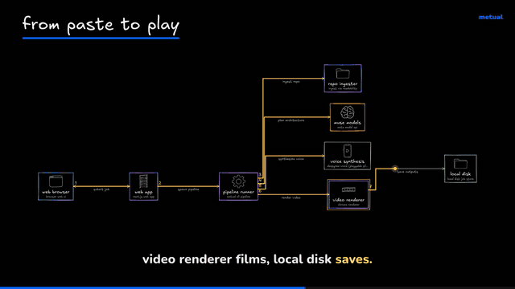
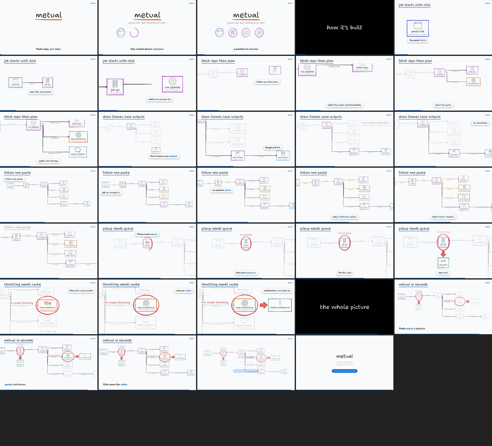
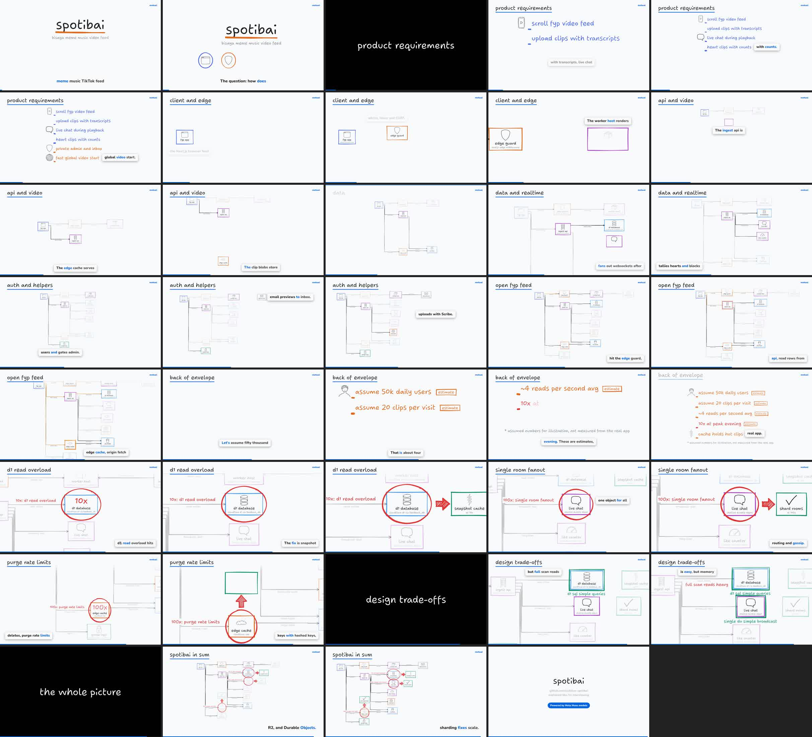

# metual

Paste a GitHub repo, an X post or an article. Get a **whiteboard explainer video** (mp4) and an **editable board** of it (a `.tldr` file that opens in tldraw.com).

- A light whiteboard, marker-pen lines that swell and thin, a friendly handwriting font (Shantell Sans), and colors that mean something: red = problem, orange/yellow = key idea, green = fix, blue = actors.
- **Repos** become a system design explainer on one evolving canvas: the architecture is built layer by layer, a dot walks one real request through it, then red circles show what breaks at 10x/100x and green boxes show the fix. Every box is grounded in files from the repo, and a second model pass reviews each box against the code before anything is drawn.
- **Posts and articles** become an annotated screenshot of the source (quotes underlined and boxed) followed by small concept boards. Every board node carries a verbatim quote from the source as evidence; quotes that are not in the source are dropped.
- **Levels**: explain it like I'm 5, I'm new, I'm interviewing, or I'm senior. Interviewing adds requirements, a back-of-envelope estimate and trade-offs; senior adds failure modes, consistency and cost. Every assumed number is tagged as an estimate on screen.
- **Interactive**: in the web app, tap any box for a grounded explanation, get a 15-20 s deep-dive clip on it, or ask "what if 10x traffic?".

### Metual explaining Metual

This is Metual run on its own repo (`--level new`, $0.15 of Muse Spark and $0.04 of voice), in the default `pen-light` look:





The older black `caleb-dark` look and the plainer `whiteboard-light` look are one flag away (`--theme caleb-dark`). The same pipeline at `--level interviewing`, on a small music app (slubbles/spotibai), with back-of-envelope numbers and what breaks at 10x and 100x:



Powered by Meta Muse models (Muse Spark for reading and planning, Muse Transcribe for voiceover QA, Muse Image + SAM for the doodle icon pack). Voice by Deepgram Aura.

## Quick start

```bash
pnpm install
cp .env.example .env        # add MODEL_API_KEY, optionally DEEPGRAM_API_KEY
npx playwright-core install chromium   # or set METUAL_CHROME to an installed Chrome

# a repo (GitHub URL or local path)
node packages/cli/bin/metual.mjs https://github.com/umami-software/umami --level new
# an article or X post
node packages/cli/bin/metual.mjs https://blog.vllm.ai/2023/06/20/vllm.html --level five
```

Needs Node 20+, ffmpeg on PATH, and Chrome/Chromium.

Outputs land in `metual-out/<name>-<level>/`:

| file | what |
| --- | --- |
| `<name>.mp4` | 1920x1080 video with narration and karaoke captions |
| `<name>.tldr` | the full diagram as an editable board; open it in tldraw.com and keep editing (see below) |
| `<name>.contact.jpg` | contact sheet of frames, for a quick look |
| `architecture.json`, `review.json` | repo only: components, evidence files, review verdict |
| `plan.json` | scenes and narration (cached; delete it or use `--fresh` to re-plan) |
| `manifest.json` | outputs, timings, voice QA score, and model/voice spend |

### CLI options

```
metual <github-url | local-repo-dir | x.com post url | article url> [options]
  --level <five|new|interviewing|senior>   default new
  --level-file <file.json>                 your own level (see docs/plugins.md)
  --theme <pen-light|caleb-dark|whiteboard-light>   default pen-light
  --out <dir>                              output folder
  --name <owner/repo>                      display name (useful for local folders)
  --voice <deepgram|silent>                default deepgram when DEEPGRAM_API_KEY is set
  --pack <id|dir>                          component/icon pack (repeatable; default: all built-in packs,
                                           used only where they detect something)
  --no-packs                               only the base doodle icons
  --fresh                                  ignore cached architecture/plan
  --workers <n>                            parallel frame renderers
  --no-qa                                  skip the Muse Transcribe voiceover check
  --pace <lively|calm>                     lively: new shot every ~2.7 s, section cards, captions by the boxes (default lively)
  --export <tldr|excalidraw>               editable board file (default tldr; excalidraw writes a .excalidraw instead)
  --json                                   progress as JSON lines (used by the web app)

follow-ups on an earlier repo run (same input, new --out):
  --from <earlier out dir> --focus <component id>   15-20 s deep dive on one box
  --from <earlier out dir> --what-if <10x|100x>     what breaks if traffic grows
metual explain --from <earlier out dir> --component <id>   text explanation of one box
```

Every run prints its spend (Meta models and voice, in USD) and writes it to `manifest.json`; with `--json` the running total comes with every progress event.

## Web app

```bash
pnpm --filter @metual/web build && pnpm --filter @metual/web start   # http://localhost:3000
```

Paste a link, pick a level, and watch progress with a live cost meter. When it finishes:

- **Play** the video. Hit areas over the diagram line up with the boxes; tap one for a short explanation from Muse Spark, grounded in that box's evidence files, and a button to render a 15-20 s deep-dive clip on it.
- **What if 10x traffic?** renders a follow-up clip that circles what breaks and draws the fix. Every number in it is labelled as an assumption.
- **Open in tldraw**: download the `.tldr` and open it in tldraw.com to keep editing (steps below).

Jobs are written to disk (`METUAL_JOBS_DIR`, default `metual-out/web`), so they survive restarts. URLs pointing at private networks are refused, and local paths are only accepted with `METUAL_ALLOW_LOCAL=1`.

### Deploying it safely

It is not deployed publicly on purpose: every job spends the operator's API credits. Before putting it on the internet you need:

- `METUAL_DEMO_ONLY=1` to only play example videos, **or** bring-your-own-key: users paste their own Meta / Deepgram keys, which are used per request and never stored. BYO key is not built yet.
- Rate limits: `METUAL_JOBS_PER_HOUR` (default 20) and one running job at a time are built in. Per-IP limits and auth are not.
- SSRF: the hostname check blocks private ranges, but it does not resolve DNS, so a public name pointing at a private IP (DNS rebinding) would get through. Resolve and re-check the IP before fetching, or run ingest in a sandbox with no internal network.
- Isolation: clone and render in a throwaway sandbox (repos are untrusted input), with disk and time limits.

## Keep editing the board

Every run saves `<name>.tldr` next to the video. It is written by Metual's own exporter from tldraw's public file format; no tldraw code is bundled.

1. Go to [tldraw.com](https://www.tldraw.com) and sign in (free; importing files needs an account).
2. Open the account menu and choose **Import file…**, then pick the `.tldr`. Dragging the file onto the canvas works too.
3. Every box is a normal rectangle grouped with its icon, every arrow is tied to its boxes, and every note is plain text, so you can move, restyle or add to anything.

Want Excalidraw instead? Run with `--export excalidraw` and open the `.excalidraw` at excalidraw.com (menu, Open).

## How it works

```
packages/
  core     contract: schemas (zod), levels, themes, text rules
  models   Meta Model API client (Muse Spark JSON-schema chat, Muse Image, SAM, Muse Transcribe) + cost ledger
  ingest   repo digest (secret files never opened, secrets redacted), X post via fxtwitter, article via Readability; source card screenshot + quote boxes
  planner  architecture extraction -> validation against real files -> review pass -> revise; scene planning per level
  voice    Deepgram Aura TTS + Nova word timestamps (cached), or silent timing
  render   elk layout -> rough.js strokes (marker-pen outlines via perfect-freehand) -> one SVG world with camera keyframes -> Playwright frames -> ffmpeg; .tldr and .excalidraw export
  cli      `metual` command and the pipeline
apps/web   Next.js front end
```

Animation events (a box drawing in, an arrow, a circle) are timed to the word in the narration that names them, using the word timestamps, so the drawing follows the voice.

## Plugins

See [docs/plugins.md](docs/plugins.md). There are three plugin points:

- **Packs** are folders with a `manifest.json` that add icons and *components*: building blocks detected from file evidence. For example, `d1_databases` in `wrangler.jsonc` means a D1 database. Detected blocks are passed to the architecture pass as hints and get consistent icons. Two packs are built in: `cloudflare` and `cloud-generic` (AWS/GCP/Azure-style object store, queues, functions, CDN and more). Both use doodle icons only, with no vendor logos. A worked example lives in [examples/packs/supabase](examples/packs/supabase).
- **Themes**: `pen-light` (default), `caleb-dark` and `whiteboard-light` are built in. Add your own with `registerTheme()`.
- **Levels** are JSON files (`--level-file`). Example: [examples/levels/product-manager.json](examples/levels/product-manager.json).

## Tests

```bash
pnpm test        # schemas, levels, themes, quote matching, note/architecture validators, packs, secret redaction, URL validation
pnpm typecheck
```

## Honest notes

- Article screenshots are a reader view that Metual renders itself (title, byline and the paragraphs that hold the quotes), not a capture of the original site. X posts are rendered as Metual's own card from public post data. Neither uses X's or any site's branding.
- Repo understanding comes from a digest of the repo (tree, manifests, entry points, configs), not the whole codebase; the review pass and the "no box without file evidence" rule keep it honest, but very large monorepos get simplified.
- Voiceover QA transcribes the final narration with Muse Transcribe and reports word overlap with the script in `manifest.json`.

## License

MIT, see [LICENSE](LICENSE). Fonts and libraries: see [THIRD_PARTY_NOTICES.md](THIRD_PARTY_NOTICES.md). Not affiliated with or endorsed by Meta.
