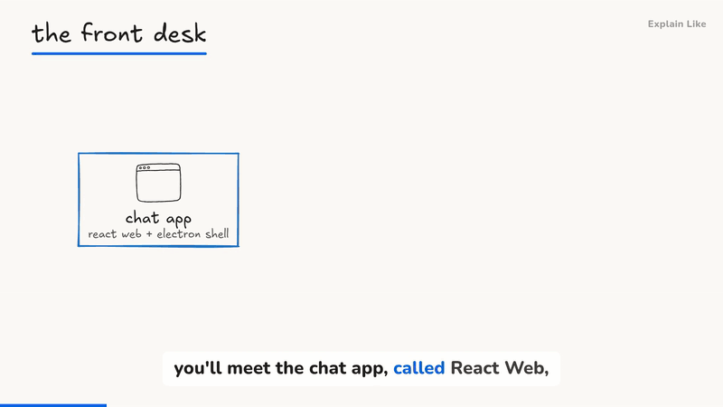
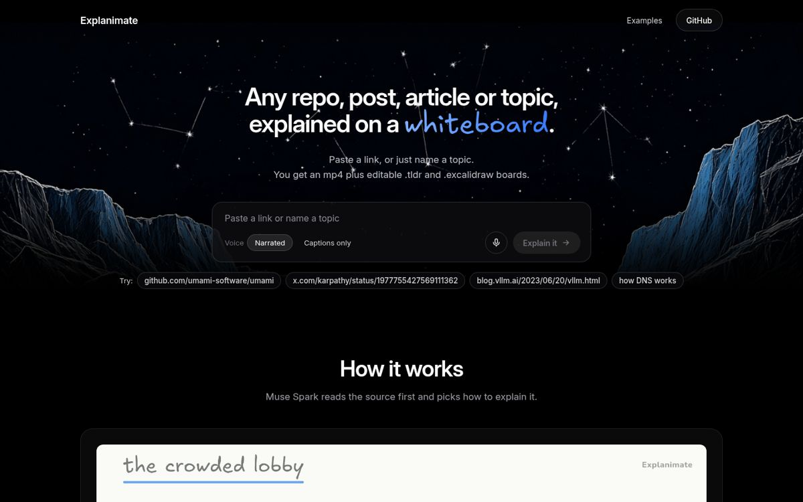
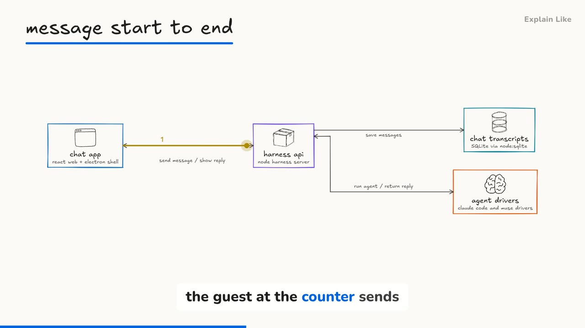
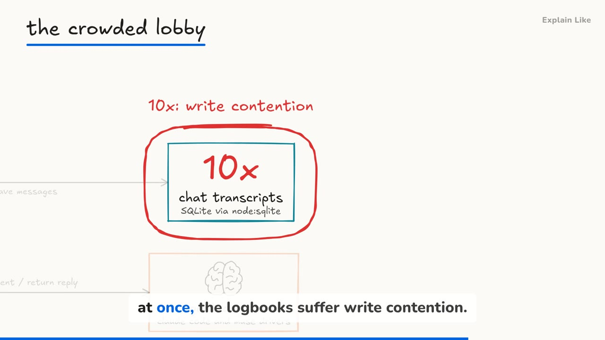
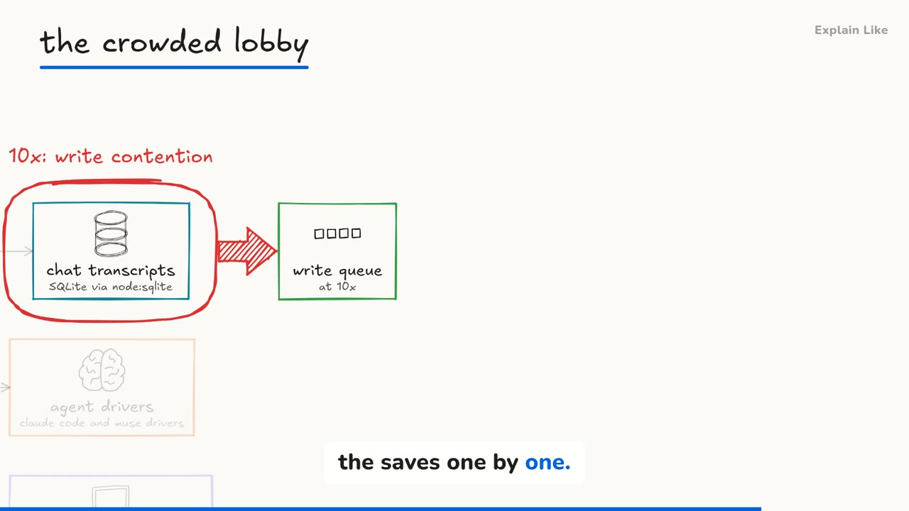
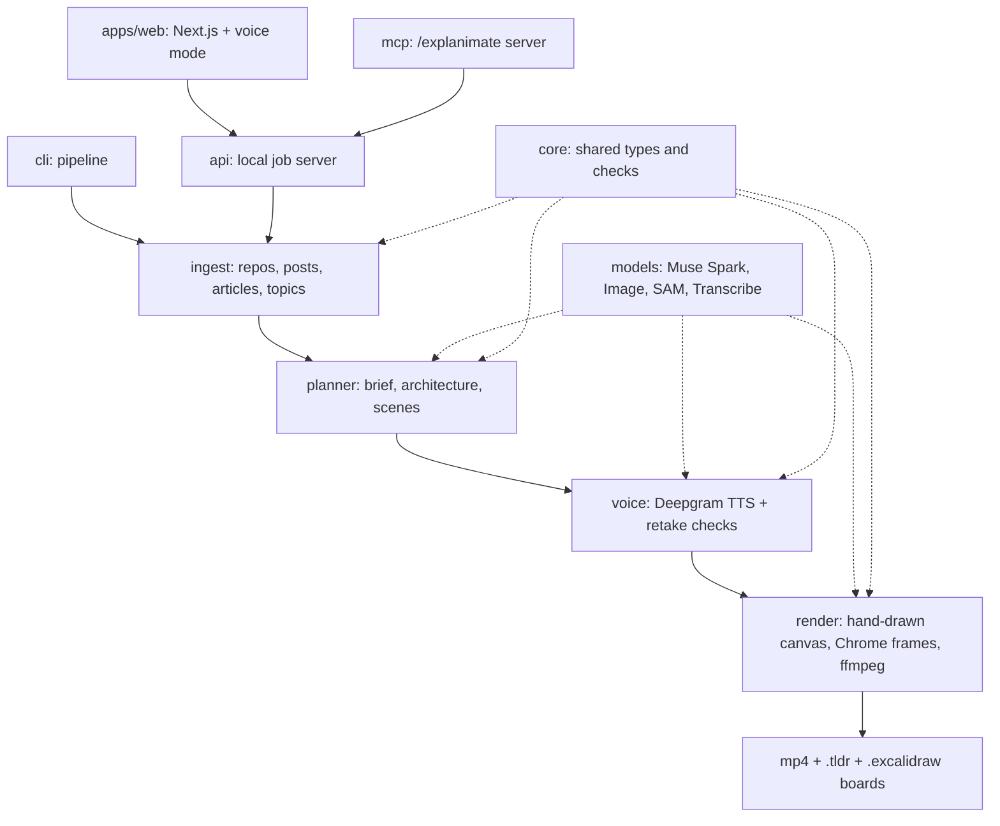

# Explanimate

Give it a GitHub repo, an article, an X post, or just a topic ("how DNS works"). It gives you back a narrated **whiteboard explainer video** and the same drawing as **editable boards** you can open in [tldraw](https://www.tldraw.com) or [Excalidraw](https://excalidraw.com).

Try it live at https://explanimate.co, or run it yourself below.

## How it works



_Above: 12 seconds from a 2-minute video about [milind-soni/OpenMausBot](https://github.com/milind-soni/OpenMausBot). A run like this costs well under $0.20 in models and voice._



1. **Paste a link or a topic.** A repo, an article, an X post, or just words on the site or the CLI.
2. **Muse plans the explanation.** It reads the source, maps the architecture against the code, and writes the narration.
3. **The board draws itself in sync.** Deepgram speaks each scene while the hand-drawn board builds on the words being said.
4. **Take the video and the boards.** An mp4 plus `.tldr` and `.excalidraw` boards, with a manifest of every check that ran.

## What it does

- **Repos** become a system design walkthrough on one canvas. It builds the architecture piece by piece, walks one real request through it, then circles what breaks at 10x traffic and draws the fix. Every box is tied to real files in the repo, and a second pass checks each box against the code before anything is drawn.
- **Articles and X posts** become an annotated view of the source, quotes underlined, followed by small concept boards. Every point carries a word-for-word quote from the source.
- **Nothing to configure.** Muse Spark reads the source first and picks how to explain it (an analogy, a story, step by step...), how deep to go, how fast and which look.
- **Checked before you see it.** Labels and arrows are checked against the camera before rendering, the finished frames are checked for cut-off words, overlaps and blank frames, and both boards are read back to make sure they open.

| A request, start to end                                                        | What breaks at 10x                                                                  | The fix                                                                    |
| ------------------------------------------------------------------------------ | ----------------------------------------------------------------------------------- | -------------------------------------------------------------------------- |
|  |  |  |

## Quick start

You need Node 20+, pnpm, ffmpeg on your PATH and Chrome or Chromium.

```bash
git clone https://github.com/slubbles/explanimate && cd explanimate
pnpm install
cp .env.example .env                    # add OPENROUTER_API_KEY (Muse Spark plans through OpenRouter)
                                        # MODEL_API_KEY is still needed for doodle icons and the voiceover check;
                                        # DEEPGRAM_API_KEY adds the voice
npx playwright-core install chromium    # or point EXPLANIMATE_CHROME at an installed Chrome

pnpm explanimate https://github.com/milind-soni/OpenMausBot
```

Without a Deepgram key the video renders silent, with timed captions. Every run prints what it spent.

Results land in `explanimate-out/<name>/`:

- `<name>.mp4`: the 1920x1080 video, with narration and captions
- `<name>.tldr` and `<name>.excalidraw`: the drawing as boards you can keep editing
- `<name>.contact.jpg`: a sheet of frames for a quick look
- `manifest.json`: what was made, the check results and the spend

The plan and voiceover are cached in that folder, so running the same source again costs almost nothing. A GitHub repo's plan is also kept per commit in `~/.cache/explanimate/plans`, so a new folder for the same commit, asked the same way, skips the Muse planning calls too; a change to the planner code or a new commit plans again. Use `--fresh` to plan again, or set `EXPLANIMATE_PLAN_CACHE=0` to turn the shared cache off.

## Web app, with voice mode

```bash
pnpm web    # http://localhost:3000
```

Paste a link and watch it build, with a live cost meter. Or press the **mic button** and just say what you want explained. The assistant talks back, asks what you want to understand and who it's for, then starts the video. You can interrupt it at any time, and a small box under the chat takes a typed link, since spoken names get misheard. Voice mode needs `DEEPGRAM_API_KEY`.

When the video is done you can tap any box for a short explanation from the code, render a 15-20 s deep dive on it, ask "what if 10x traffic?", or download the boards.

Every job spends your API credits. The web app has a per-IP rate limit, size limits and a spend guard that pauses new work before the Meta or Deepgram cap (`EXPLANIMATE_META_CAP_USD`, `EXPLANIMATE_VOICE_CAP_USD`). Voice mode only answers on localhost. Read [docs/deploy.md](docs/deploy.md) before you put it anywhere public.

If a server restart cuts a video off, it starts again on its own the next time the app loads. Every setting is listed in [`.env.example`](.env.example).

## Checks

```bash
pnpm typecheck && pnpm test
```

The tests need ffmpeg and Chrome but no API keys.

## CLI

```
pnpm explanimate <github url | local repo folder | article url | x.com post url | "a topic"> [options]

  --out <dir>                 output folder (default ./explanimate-out/<name>)
  --voice <deepgram|silent>   default: deepgram when DEEPGRAM_API_KEY is set
  --fresh                     plan again instead of using the cached plan
  --goal <text>               what you want to understand
  --audience <text>           who it is for
  --depth <overview|working|deep>
  --workers <n>               threads (Skia) or Chrome processes drawing frames
  --no-music, --no-qa         skip the music bed, skip the voiceover check
  --json                      progress as JSON lines
  --allow-private             read links that resolve to private or localhost addresses (local intranet only)

follow-ups on an earlier repo run:
  --from <earlier out dir> --focus <box id>       15-20 s deep dive on one box
  --from <earlier out dir> --what-if <10x|100x>   what breaks if traffic grows
```

`pnpm explanimate --help` lists the rest.

## /explanimate in your coding agent

`packages/mcp` is an MCP server that runs Explanimate on your own machine. Add it to your agent, then ask. Full setup with copy-paste configs for every tool: https://explanimate.co/docs

```
/explanimate explain what this repo is about https://github.com/milind-soni/OpenMausBot
```

It renders locally and answers with the paths to the mp4 and both boards. Say "this repo" without a link and it explains the folder you're in. Files go to `~/explanimate-videos/<name>`. A render takes a few minutes, so the agent checks back with `explain_status` while it works.

Replace `/path/to/explanimate` below with where you cloned this repo.

**Muse Code**, in `~/.config/muse/settings.json` (merge with what's there):

```json
{
  "schema_version": 1,
  "mcp_servers": {
    "explanimate": {
      "transport": "stdio",
      "command": "node",
      "args": ["/path/to/explanimate/packages/mcp/bin/explanimate-mcp.mjs"],
      "env": { "MODEL_API_KEY": "${MODEL_API_KEY}", "DEEPGRAM_API_KEY": "${DEEPGRAM_API_KEY}" },
      "mode": "optional"
    }
  }
}
```

**Claude Desktop**, in `claude_desktop_config.json` (Settings, Developer, Edit Config). It doesn't read your shell environment, so the keys go in the file. Keep it private.

```json
{
  "mcpServers": {
    "explanimate": {
      "command": "node",
      "args": ["/path/to/explanimate/packages/mcp/bin/explanimate-mcp.mjs"],
      "env": { "MODEL_API_KEY": "your Meta key", "DEEPGRAM_API_KEY": "your Deepgram key" }
    }
  }
}
```

**Cursor**, in `~/.cursor/mcp.json` or `.cursor/mcp.json` in a project:

```json
{
  "mcpServers": {
    "explanimate": {
      "command": "node",
      "args": ["/path/to/explanimate/packages/mcp/bin/explanimate-mcp.mjs"],
      "env": { "MODEL_API_KEY": "${env:MODEL_API_KEY}", "DEEPGRAM_API_KEY": "${env:DEEPGRAM_API_KEY}" }
    }
  }
}
```

**Claude Code**, in a terminal:

```bash
claude mcp add explanimate --transport stdio \
  --env MODEL_API_KEY=your-meta-key \
  --env DEEPGRAM_API_KEY=your-deepgram-key \
  -- node /path/to/explanimate/packages/mcp/bin/explanimate-mcp.mjs
```

**Codex**, in `~/.codex/config.toml` (then restart Codex):

```toml
[mcp_servers.explanimate]
command = "node"
args = ["/path/to/explanimate/packages/mcp/bin/explanimate-mcp.mjs"]

[mcp_servers.explanimate.env]
MODEL_API_KEY = "your Meta key"
DEEPGRAM_API_KEY = "your Deepgram key"
```

**VS Code**, in `.vscode/mcp.json` in your workspace (its format uses the `servers` key):

```json
{
  "servers": {
    "explanimate": {
      "type": "stdio",
      "command": "node",
      "args": ["/path/to/explanimate/packages/mcp/bin/explanimate-mcp.mjs"],
      "env": { "MODEL_API_KEY": "your Meta key", "DEEPGRAM_API_KEY": "your Deepgram key" }
    }
  }
}
```

Want to call it from your own code instead? `packages/api` runs the same jobs over a localhost HTTP API (`node packages/api/bin/explanimate-api.mjs`).

## How it works

1. **Read.** It takes a digest of the repo (file tree, manifests, entry points, configs; secret files are never opened) or the article's text. A plain topic is looked up on Wikipedia, and the article plus up to two reputable pages it cites (standards bodies, universities, governments, major outlets) are read; every quote on screen comes from them, and the sources are named in the video, `sources.md` and the manifest.
2. **Plan.** Muse Spark maps the architecture, checks every box against real files, picks an approach and writes the scenes and narration.
3. **Voice.** Deepgram Aura reads the script, and word timestamps let each box draw in on the word that names it.
4. **Draw.** The scenes become one hand-drawn SVG canvas with a moving camera. Skia draws the frames on a few threads and streams them into ffmpeg (NVENC when a GPU is there, else libx264). Set `EXPLANIMATE_RENDERER=chrome` to draw them in headless Chrome instead; Skia falls back to Chrome on its own if it cannot load.
5. **Check.** The frames and both boards are checked, and the voiceover is transcribed back and compared with the script.

The code is a pnpm workspace: `packages/` holds `core`, `models`, `ingest`, `planner`, `voice`, `render`, `cli`, `api` and `mcp`, and `apps/web` is the Next.js app. Icon packs are a plugin point; see [docs/plugins.md](docs/plugins.md). Run the tests with `pnpm test` and `pnpm typecheck`.

### Architecture



## License

MIT, see [LICENSE](LICENSE). Fonts and libraries are listed in [THIRD_PARTY_NOTICES.md](THIRD_PARTY_NOTICES.md). Not affiliated with or endorsed by Meta, tldraw or Excalidraw.
