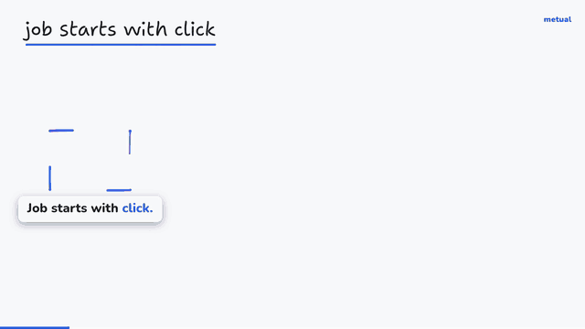
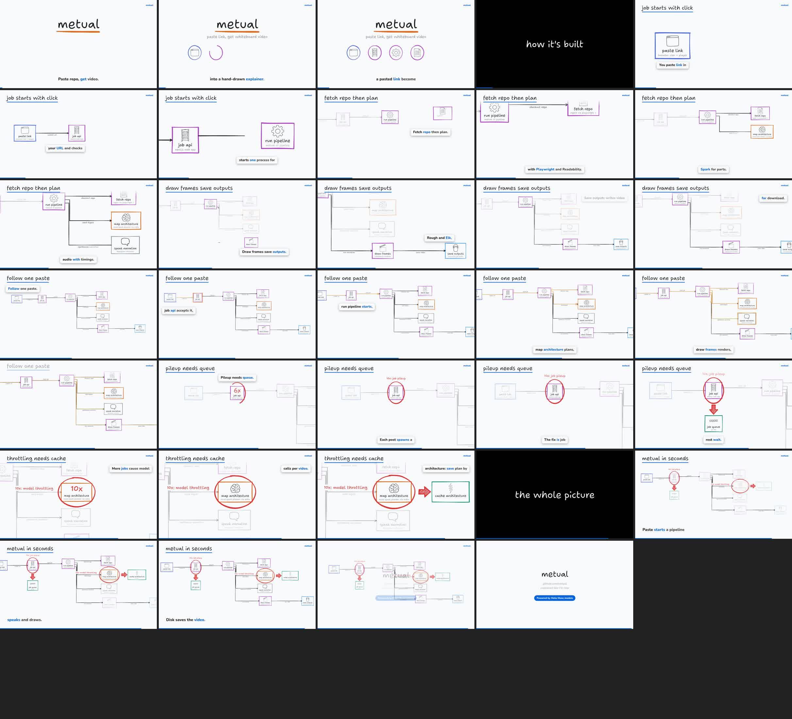

# Explain Like

Paste a GitHub repo, an X post or an article. Get a **whiteboard explainer video** (mp4) and **editable boards** of it (a `.tldr` for tldraw.com and an `.excalidraw` for excalidraw.com).

- A light whiteboard, marker-pen lines that swell and thin, a friendly handwriting font (Shantell Sans), and colors that mean something: red = problem, orange/yellow = key idea, green = fix, blue = actors.
- **Repos** become a system design explainer on one evolving canvas: the architecture is built layer by layer, a dot walks one real request through it, then red circles show what breaks at 10x/100x and green boxes show the fix. Every box is grounded in files from the repo, and a second model pass reviews each box against the code before anything is drawn.
- **Posts and articles** become an annotated screenshot of the source (quotes underlined and boxed) followed by small concept boards. Every board node carries a verbatim quote from the source as evidence; quotes that are not in the source are dropped.
- **No levels or themes to pick**: Muse Spark reads the source first and decides the approach (analogy, story, step by step, build-up, compare, problem then solution), the depth, the tempo and the look. Simple topics run brisk, technical ones slower. Every assumed number is tagged as an estimate on screen.
- **Paced for watching**: every shot holds at least 3.5 s (4 s steady, 4.8 s slow), 8 to 15 cuts a minute, eased camera moves, one title on screen at a time, and the camera never moves while a ring or arrow draws. Captions sit in one fixed band at the bottom; the music bed sits about 22 dB under the voice.
- **Checked twice**: before rendering, every ring, arrow and label is checked against the camera plan and moved until it sits where it should. After rendering, the frames themselves are measured for cut-off words, overlaps, captions over drawings, tiny text and blank frames (`frame-check.json`). Both boards are read back and checked too (`board-check.json`).
- **Interactive**: in the web app, tap any box for a grounded explanation, get a 15-20 s deep-dive clip on it, or ask "what if 10x traffic?".

### Explain Like explaining Explain Like

This is an earlier build of Explain Like run on its own repo ($0.15 of Muse Spark and $0.04 of voice), in the `pen-light` look:





The same pipeline on a small music app (karpathy/minbpe), with back-of-envelope numbers and what breaks at 10x and 100x:


Powered by Meta Muse models (Muse Spark for reading and planning, Muse Transcribe for voiceover QA, Muse Image + SAM for the doodle icon pack). Voice by Deepgram Aura.

## Quick start

```bash
pnpm install
cp .env.example .env        # add MODEL_API_KEY, optionally DEEPGRAM_API_KEY
npx playwright-core install chromium   # or set EXPLAINLIKE_CHROME to an installed Chrome

# a repo (GitHub URL or local path)
node packages/cli/bin/explainlike.mjs https://github.com/umami-software/umami
# an article or X post
node packages/cli/bin/explainlike.mjs https://blog.vllm.ai/2023/06/20/vllm.html
```

Needs Node 20+, ffmpeg on PATH, and Chrome/Chromium.

Outputs land in `explainlike-out/<name>/`:

| file | what |
| --- | --- |
| `<name>.mp4` | 1920x1080 video with narration and karaoke captions |
| `<name>.tldr` | the full diagram as an editable board; open it at tldraw.com and keep editing (see below) |
| `<name>.excalidraw` | the same board for excalidraw.com |
| `placement.json` | what the pre-render check moved, and anything left |
| `frame-check.json` | the post-render frame check: sampled times and any issues |
| `board-check.json` | the read-back check of both boards |
| `<name>.contact.jpg` | contact sheet of frames, for a quick look |
| `architecture.json`, `review.json` | repo only: components, evidence files, review verdict |
| `plan.json` | scenes and narration (cached; delete it or use `--fresh` to re-plan) |
| `manifest.json` | outputs, the brief, pacing numbers, check results, voice QA score, and model/voice spend |

### CLI options

```
explainlike <github-url | local-repo-dir | x.com post url | article url> [options]
  --out <dir>                              output folder (default ./explainlike-out/<name>)
  --name <owner/repo>                      display name (useful for local folders)
  --voice <deepgram|silent>                default deepgram when DEEPGRAM_API_KEY is set
  --pack <id|dir>                          component/icon pack (repeatable; default: all built-in packs,
                                           used only where they detect something)
  --no-packs                               only the base doodle icons
  --fresh                                  ignore cached architecture/plan
  --workers <n>                            parallel frame renderers
  --no-qa                                  skip the Muse Transcribe voiceover check
  --no-music                               no music bed
  --vision-review                          also show 8 rendered frames to Muse Spark (costs a little; off by default)
  --json                                   progress as JSON lines (used by the web app)

follow-ups on an earlier repo run (same input, new --out):
  --from <earlier out dir> --focus <component id>   15-20 s deep dive on one box
  --from <earlier out dir> --what-if <10x|100x>     what breaks if traffic grows
explainlike explain --from <earlier out dir> --component <id>   text explanation of one box
```

Every run prints its spend (Meta models and voice, in USD) and writes it to `manifest.json`; with `--json` the running total comes with every progress event.

## Web app

```bash
pnpm --filter @explainlike/web build && pnpm --filter @explainlike/web start   # http://localhost:3000
```

Paste a link and watch progress with a live cost meter. When it finishes:

- **Play** the video. Hit areas over the diagram line up with the boxes; tap one for a short explanation from Muse Spark, grounded in that box's evidence files, and a button to render a 15-20 s deep-dive clip on it.
- **What if 10x traffic?** renders a follow-up clip that circles what breaks and draws the fix. Every number in it is labelled as an assumption.
- **Download .tldr** or **.excalidraw**: save a board file and keep editing it (steps below).

Jobs are written to disk (`EXPLAINLIKE_JOBS_DIR`, default `explainlike-out/web`), so they survive restarts. URLs pointing at private networks are refused, and local paths are only accepted with `EXPLAINLIKE_ALLOW_LOCAL=1`.

### Deploying it safely

It is not deployed publicly on purpose: every job spends the operator's API credits. Before putting it on the internet you need:

- `EXPLAINLIKE_DEMO_ONLY=1` to only play example videos, **or** bring-your-own-key: users paste their own Meta / Deepgram keys, which are used per request and never stored. BYO key is not built yet.
- Rate limits: `EXPLAINLIKE_JOBS_PER_HOUR` (default 20) and one running job at a time are built in. Per-IP limits and auth are not.
- SSRF: the hostname check blocks private ranges, but it does not resolve DNS, so a public name pointing at a private IP (DNS rebinding) would get through. Resolve and re-check the IP before fetching, or run ingest in a sandbox with no internal network.
- Isolation: clone and render in a throwaway sandbox (repos are untrusted input), with disk and time limits.

## Keep editing the board

Every run saves `<name>.tldr` and `<name>.excalidraw` next to the video. Both are written by Explain Like's own exporters from each tool's public file format, then read back and checked. No tldraw SDK or code is bundled, Explain Like uses no tldraw logo or branding, and Explain Like itself stays MIT.

1. Go to [tldraw.com](https://www.tldraw.com) and sign in (free; importing files needs an account).
2. Open the account menu and choose **Import file…**, then pick the `.tldr`. Dragging the file onto the canvas works too.
3. Every box is a normal rectangle grouped with its icon, every arrow is tied to its boxes, and every note is plain text, so you can move, restyle or add to anything.

For Excalidraw, open the `.excalidraw` at excalidraw.com (menu, Open).

## Use it from your coding agent (MCP)

`packages/mcp` is an MCP server (`explainlike-mcp`, stdio) that runs Explain Like on your own machine. Ask your agent something like

```
/explainlike explain what this repo is about https://github.com/milind-soni/OpenMausBot
```

and it renders the video locally and answers with the paths of the mp4, the `.tldr` and the `.excalidraw`. The keys are read from the environment the client gives the server (`MODEL_API_KEY`, `DEEPGRAM_API_KEY`); nothing is uploaded except the calls to the Meta Model API and Deepgram that every run makes.

What the server offers:

- **`explain`**: `source` (a GitHub, x.com or article URL, or a local repo folder), plus optional `question` (what you want to understand), `audience`, `depth` (`overview`, `working`, `deep`), `alsoCover`, `outDir`, `voice` (`deepgram` or `silent`) and `fresh`. Follow-up clips take `followUpOf` (an earlier repo video's folder) with `focus` (a component id) or `whatIf` (`10x`, `100x`).
- **`explain_status`**: progress, then the paths once it is done. It is marked read-only, so clients that skip approval for read-only tools poll it without asking.
- **`explain_cancel`**: stop a render.
- **`explainlike`** prompt: shows up as `/explainlike` in clients that list MCP prompts as commands. In clients that don't, a plain request such as "explain what this repo is about <url>" works the same way.

A render takes a few minutes, longer than many clients wait for one tool call. So `explain` waits up to 50 s (`EXPLAINLIKE_MCP_WAIT_SEC`), sending MCP progress notifications while it works, then returns a job id that `explain_status` keeps waiting on. One render runs at a time.

Files go to `~/explainlike-videos/<name>` unless you pass `outDir` or set `EXPLAINLIKE_OUT_DIR`. Running the same source again into the same folder reuses its plan and voiceover, so it costs almost nothing; `fresh` plans again. A `question` gets its own folder, because it changes the plan.

Replace `/path/to/explainlike` with where you cloned this repo (after `pnpm install`).

**Muse Code**: in `~/.config/muse/settings.json` (merge with what is there; Muse Code fills `${VAR}` from your shell environment):

```json
{
  "schema_version": 1,
  "mcp_servers": {
    "explainlike": {
      "transport": "stdio",
      "command": "node",
      "args": ["/path/to/explainlike/packages/mcp/bin/explainlike-mcp.mjs"],
      "env": { "MODEL_API_KEY": "${MODEL_API_KEY}", "DEEPGRAM_API_KEY": "${DEEPGRAM_API_KEY}" },
      "mode": "optional"
    }
  }
}
```

`mode: "optional"` means Muse Code starts without it, with a warning, if the server can't start. Check it with `/mcp` inside Muse Code.

**Claude Desktop**: in `claude_desktop_config.json` (Settings, Developer, Edit Config):

```json
{
  "mcpServers": {
    "explainlike": {
      "command": "node",
      "args": ["/path/to/explainlike/packages/mcp/bin/explainlike-mcp.mjs"],
      "env": { "MODEL_API_KEY": "your Meta Model API key", "DEEPGRAM_API_KEY": "your Deepgram key" }
    }
  }
}
```

Claude Desktop does not read your shell environment, so the keys go in this file. Keep it private.

**Cursor**: in `~/.cursor/mcp.json` (or `.cursor/mcp.json` in a project):

```json
{
  "mcpServers": {
    "explainlike": {
      "command": "node",
      "args": ["/path/to/explainlike/packages/mcp/bin/explainlike-mcp.mjs"],
      "env": { "MODEL_API_KEY": "${env:MODEL_API_KEY}", "DEEPGRAM_API_KEY": "${env:DEEPGRAM_API_KEY}" }
    }
  }
}
```

To try the server without any client: `pnpm --filter explainlike-mcp try https://github.com/owner/repo [outDir]` starts it over stdio, calls `explain` and prints the progress and the result.

### Local HTTP API

`packages/api` runs the same jobs from code (`new JobRunner().start({ input })`) or over HTTP on your machine:

```bash
node packages/api/bin/explainlike-api.mjs            # http://127.0.0.1:7311 (--port or EXPLAINLIKE_API_PORT)
curl -s -X POST localhost:7311/v1/jobs -H 'content-type: application/json' \
  -d '{"input":"https://github.com/milind-soni/OpenMausBot","goal":"how a chat message reaches the tools"}'
curl -s 'localhost:7311/v1/jobs/<id>?wait=60'        # waits up to 60 s, then returns the job: state, pct, message, outputs
curl -s -X DELETE localhost:7311/v1/jobs/<id>        # cancel
```

The JSON body takes `input` plus the same options as the `explain` tool, named as in `JobRequest` (`goal`, `audience`, `depth`, `also`, `out`, `voice`, `fresh`, `from`, `focus`, `whatIf`). It only listens on 127.0.0.1 and refuses requests from web pages (any `Origin` header) or another `Host`, so a site you visit can't start a paid render. There is no auth, so don't expose the port.

## How it works

```
packages/
  core     contract: schemas (zod), the brief and tempos, looks, text rules
  models   Meta Model API client (Muse Spark JSON-schema chat, Muse Image, SAM, Muse Transcribe) + cost ledger
  ingest   repo digest (secret files never opened, secrets redacted), X post via fxtwitter, article via Readability; source card screenshot + quote boxes
  planner  architecture extraction -> validation against real files -> review pass -> revise; the brief (approach, depth, tempo, look) -> scene planning
  voice    Deepgram Aura TTS + Nova word timestamps (cached), or silent timing
  render   elk layout -> rough.js strokes (marker-pen outlines via perfect-freehand) -> one SVG world with camera keyframes -> placement check -> Playwright frames -> frame check -> ffmpeg; checked .tldr and .excalidraw export
  cli      `explainlike` command and the pipeline
  api      job runner (spawns the CLI, tracks progress and outputs) + localhost HTTP API
  mcp      `explainlike-mcp` MCP server over stdio: explain, explain_status, explain_cancel, /explainlike
apps/web   Next.js front end
```

Animation events (a box drawing in, an arrow, a circle) are timed to the word in the narration that names them, using the word timestamps, so the drawing follows the voice.

## Plugins

See [docs/plugins.md](docs/plugins.md). There is one plugin point:

- **Packs** are folders with a `manifest.json` that add icons and *components*: building blocks detected from file evidence. For example, `d1_databases` in `wrangler.jsonc` means a D1 database. Detected blocks are passed to the architecture pass as hints and get consistent icons. Two packs are built in: `cloudflare` and `cloud-generic` (AWS/GCP/Azure-style object store, queues, functions, CDN and more). Both use doodle icons only, with no vendor logos. A worked example lives in [examples/packs/supabase](examples/packs/supabase).

## Tests

```bash
pnpm test        # schemas, the brief, quote matching, validators, packs, secret redaction, URL validation, pacing, placement, frame and board checks
pnpm typecheck
```

## Honest notes

- Article screenshots are a reader view that Explain Like renders itself (title, byline and the paragraphs that hold the quotes), not a capture of the original site. X posts are rendered as Explain Like's own card from public post data. Neither uses X's or any site's branding.
- Repo understanding comes from a digest of the repo (tree, manifests, entry points, configs), not the whole codebase; the review pass and the "no box without file evidence" rule keep it honest, but very large monorepos get simplified.
- Voiceover QA transcribes the final narration with Muse Transcribe and reports word overlap with the script in `manifest.json`.

## License

MIT, see [LICENSE](LICENSE). Fonts and libraries: see [THIRD_PARTY_NOTICES.md](THIRD_PARTY_NOTICES.md). Not affiliated with or endorsed by Meta.
