# Explanimate: the eagle-view map

A short, plain-language map of the whole project: what it is, how a video gets made, where everything lives, and where things stand.
Based on `main` at commit `79fea54` (Nov 3, 2026, 7:04 AM Manila time). For the full handoff, read [`AGENTS.md`](../AGENTS.md).

## 1. What it is

- **Explanimate** turns a GitHub repo link, an article, an X post or a plain topic ("how DNS works") into a narrated, hand-drawn whiteboard explainer video (an mp4).
- It also gives you the same drawing as boards you can keep editing in tldraw or Excalidraw, which are free online whiteboard apps.
- An AI model (Meta's Muse Spark) reads the source, decides how to explain it and writes the script. Deepgram's voice reads the script aloud, and the engine draws every frame to match the words.
- It's Slubbles' solo entry for the Meta Global AI Developer Hackathon. **The deadline is Thu Nov 5, 2026, 10:00 AM Manila time (UTC+8).**
- The project was renamed twice: Metual, then Explain Like, now Explanimate. Old `EXPLAINLIKE_*` names and `explainlike-*` folders still work on purpose.

## 2. How a video gets made

```mermaid
flowchart LR
  A[link or topic] --> B[ingest: read it]
  B --> C[brief: pick the approach]
  C --> D[architecture map + review<br/>repos only]
  D --> E[scope: keep the core]
  E --> F[scene plan: write + check the script]
  F --> G[voice: Deepgram reads it]
  G --> H[compose: lay out the board + line cards]
  H --> I[render: draw frames, check them]
  I --> J[encode: mp4 + boards + contact sheet]
```



1. **Ingest:** downloads the repo (or fetches the article, post or topic sources) and reads the README.
2. **Brief:** Muse picks the angle (story, step by step, compare...), plus how deep and how fast to go.
3. **Architecture** (repos only): Muse names the main parts and how they connect, and each part has to point to real files. A second pass checks them against the code.
4. **Scope:** drops any part or claim the README's core doesn't back up, so the video covers what matters, not every feature.
5. **Scene plan:** Muse writes the narration line by line, with one visual per line. Checks then send back stiff wording, unexplained terms and lines where the screen doesn't match the words.
6. **Voice:** Deepgram Aura speaks each line and reports when every word is said. Muse Transcribe listens back as a check.
7. **Compose:** builds the evolving diagram and full-screen "line cards", timed to the exact words that trigger them.
8. **Render and encode:** draws every frame (Skia by default, Chrome as the backup), checks frames for cut-off or blank images, then ffmpeg (a video encoding tool) makes the mp4.

Plans, voice, repos and icons are cached, so a re-render from cache costs about $0.01. A fresh run costs about $0.40 and takes 3–5 minutes.

## 3. Folder and file map

The repo is a pnpm monorepo: one repo holding several packages that share code. `packages/` holds the engine, and `apps/web` is the website.

```
explanimate/
├── AGENTS.md                 start here: state, how to run, rules, next tasks
├── README.md                 public intro and quick start
├── .env.example              every setting, with what it does (no values)
├── package.json, pnpm-*.yaml workspace setup and shortcut commands (pnpm explanimate, pnpm web)
│
├── apps/web/                 ── WEB APP (Next.js, a React web framework)
│   ├── app/page.tsx          home page: paste a link, or press the mic
│   ├── app/gallery/page.tsx  /gallery: finished example videos
│   ├── components/           screens: InputScreen, Steps (progress), Player, ResultView, VoiceMode, GalleryGrid, Nav
│   ├── app/api/jobs/...      start a video, check progress, fetch files, explain a box, follow-up clips
│   ├── app/api/voice/...     voice-mode chat: speak, listen, take a turn (localhost only)
│   ├── app/api/health        says whether the machine can make a video right now
│   ├── lib/jobs.ts           the job store and the silent queue (one JSON file per job, no database)
│   ├── lib/guard.ts          spend guard: pauses new work before a spend cap is crossed
│   ├── lib/serve.ts, validate.ts, reach.ts   rate limits, input checks, private-address blocking
│   ├── lib/gallery.ts        reads the gallery folder and its gallery.json
│   ├── lib/steps.ts          the progress-list wording for each stage
│   └── test/                 web tests (queue, guard, gallery, voice...) with a fake CLI
│
├── packages/cli/             ── THE ENGINE'S FRONT DOOR
│   ├── src/bin.ts            `pnpm explanimate <link or topic>` and its flags (--out, --fresh, --no-qa)
│   └── src/pipeline.ts       runs every stage in order and writes manifest.json
│
├── packages/ingest/          ── READING THE SOURCE
│   ├── src/repo.ts           clones a repo at a fixed commit and builds a digest
│   ├── src/topic.ts, concept.ts   topics, articles and X posts, and the pages they cite
│   ├── src/net.ts            safe fetching: size limits, timeouts, private-address guard
│   └── src/secrets.ts        never opens files that look like secrets
│
├── packages/planner/         ── DECIDING WHAT TO SAY
│   ├── src/brief.ts          picks the approach, depth, tempo and look
│   ├── src/architecture.ts   maps the parts and connections, plus the review pass
│   ├── src/scenes.ts         writes the script and runs the self-checks and rewrites
│   ├── src/beats.ts          one visual per narration line, and the check that the words match
│   ├── src/shapes.ts         story shapes (journey, problem then fix...)
│   └── src/followups.ts      15-second deep dives and "what if 10x traffic?" clips
│
├── packages/models/          ── TALKING TO THE AI
│   └── src/index.ts          Muse Spark via OpenRouter or Meta, plus image, SAM and Transcribe; costs, retries, raced calls
│
├── packages/voice/           ── THE VOICEOVER
│   └── src/index.ts          Deepgram Aura speech with word timings, a fix-up table for misread words, a silent fallback
│
├── packages/core/            ── SHARED RULES AND SHAPES
│   ├── src/schemas.ts        the data shapes: Scene, Beat, visual types
│   ├── src/plain.ts, text.ts the plain-language and grammar rules
│   ├── src/llm.ts, env.ts    picks the AI provider and reads settings (old names too)
│   ├── src/walk.ts, figures.ts, places.ts   walkthrough matching, numbers, map places
│   └── data/naturalearth.json   world map outlines for history and geography topics
│
├── packages/render/          ── DRAWING THE VIDEO
│   ├── src/layout.ts, placement.ts   where boxes go, and the check that nothing is cut off
│   ├── src/cards.ts          full-screen line cards (kinetic words, chips, terminal, contrast...)
│   ├── src/compose.ts, film.ts, pace.ts   turn the plan into a timed film, camera moves and pacing
│   ├── src/skia.ts, skia/    the fast frame drawer (Skia, a 2D graphics library) on worker threads
│   ├── src/capture.ts, stage/   the Chrome renderer, kept as the backup
│   ├── src/renderer.ts       picks Skia or Chrome, and the video encoder
│   ├── src/framecheck.ts, check.ts, boardcheck.ts   check frames, captions and boards after drawing
│   ├── src/tldraw.ts, excalidraw.ts   EXPORTS: write the .tldr and .excalidraw boards
│   ├── src/music.ts          background music and sound effects
│   ├── packs/doodle/         about 40 hand-drawn icons (database, server, robot...)
│   └── assets/fonts/         hand-drawn fonts (Excalifont, Shantell Sans, Nunito)
│
├── packages/api/             ── LOCAL JOB API on port 7311 (/v1/jobs), used by the connector
├── packages/mcp/             ── MCP CONNECTOR: lets an AI coding tool call Explanimate
│   └── src/server.ts         tools explain / explain_status / explain_cancel, plus the /explanimate command
│
├── examples/packs/supabase/  sample icon pack (see docs/plugins.md)
├── scripts/                  check-secrets.sh (pre-commit secret scan), gen-icon-pack.ts
├── Dockerfile, .dockerignore DOCKER: one image with Node, Chromium, ffmpeg, git; data on a /data volume
├── railway.json              a Railway hosting config (health check on /api/health); not used today
├── .github/workflows/ci.yml  CI: typecheck, tests and web build on every push and PR
│
└── docs/
    ├── code-map.md           deeper engineering map: checks that can stop a run, timings, warts
    ├── deploy.md             how to run it on a server, plus DNS recipes
    ├── explaining-playbook.md   the engine's script rules
    ├── research/PLAYBOOK.md  study of Crayon Capital, Fireship, Vox, CNBC and others
    ├── research/agent-browser-sample.md   THE approved sample script: the quality bar
    ├── research/transcripts/ creator transcripts used for the study
    ├── plugins.md            how icon packs work
    ├── hackathon.md, demo-video.md   submission write-up and demo plan (drafts)
    ├── gallery.example.json  the format of the gallery list
    └── handoff/              old unmerged work saved as a patch (v3, for ideas only)
```

Tests sit in each package's `test/` folder and use Node's built-in test runner. Run them with `pnpm test`. AGENTS.md says 317 tests were passing at the last count.

## 4. Outside services (setting names only, never values)

| Service | Used for | Setting |
| --- | --- | --- |
| **OpenRouter → Muse Spark 1.3** (`meta/muse-spark-1.3`) | all planning and script writing, plus voice-mode chat. The default when its key is set. | `OPENROUTER_API_KEY` |
| **Meta Model API** | Muse Spark backup (`muse-spark-1.3-contributor`), doodle icons (Muse Image + SAM, which cuts an image out of its background), and the voiceover check (Muse Transcribe) | `MODEL_API_KEY` |
| **Deepgram** | Aura voice (`aura-2-arcas-en` for videos, `aura-2-thalia-en` for chat), Nova-3 speech-to-text in voice mode | `DEEPGRAM_API_KEY` |

With no Deepgram key, videos render silent with timed captions. Keys live in a gitignored `.env` or `apps/web/.env.local`.

## 5. Key settings

| Setting | What it does | Default |
| --- | --- | --- |
| `EXPLANIMATE_LLM_PROVIDER` | force `openrouter` or `meta` for Muse Spark | OpenRouter if its key is set |
| `EXPLANIMATE_SPARK_MODEL` | a different model name | per provider |
| `EXPLANIMATE_HEDGE` | how many copies of long AI calls to race, keeping the first answer | 2 |
| `EXPLANIMATE_RENDERER` | `skia` or `chrome` | skia |
| `EXPLANIMATE_ENCODER` | `nvenc` (graphics card) or `x264` | auto |
| `EXPLANIMATE_VOICE` / `_CHAT_VOICE` / `_STT` | the video voice, chat voice and listening model | arcas / thalia / nova-3 |
| `EXPLANIMATE_META_CAP_USD` / `_VOICE_CAP_USD` | spend caps; new work pauses before crossing them, with a warning at 80% | 25 / 10 |
| `EXPLANIMATE_META_RESERVE_USD` / `_VOICE_RESERVE_USD` | room kept free for one more job | 1 / 0.15 |
| `EXPLANIMATE_REQ_PER_MIN` / `_JOBS_PER_HOUR` | rate limits: per visitor, and for everyone combined | 12 / 20 |
| `EXPLANIMATE_CONCURRENCY` | videos rendering at once; the rest wait in line | 10 |
| `EXPLANIMATE_QUEUE_MAX` | most videos allowed to wait | 200 |
| `EXPLANIMATE_WAIT_IDLE_S` | drop a waiting video this many seconds after its tab closes | 120 |
| `EXPLANIMATE_DEMO_ONLY` | 1 = show the gallery only, refuse new videos | 0 |
| `EXPLANIMATE_RESUME` | restart jobs that a crash cut off | 1 |
| `EXPLANIMATE_TRUST_PROXY` | trust the visitor address from a proxy in front | 0 |
| `EXPLANIMATE_ALLOW_PRIVATE_URLS` | allow links to private network addresses (keep at 0 in public) | 0 in web |
| `EXPLANIMATE_JOBS_DIR` / `_GALLERY_DIR` / `_OUT_DIR` | where jobs, gallery videos and CLI output go | repo folders, `/data` in Docker |
| `EXPLANIMATE_PLAN_CACHE` | 0 turns off the shared plan cache | on |
| `EXPLANIMATE_CHROME` | Chrome path if it's not in a standard place | auto-found |
| `EXPLANIMATE_API_PORT` / `_MCP_WAIT_SEC` | local API port, and how long the connector waits per call | 7311 / 50 |

The full list is in `.env.example` and in AGENTS.md section 9.

## 6. Where things stand (as of Nov 3, 7 AM Manila)

**Done and merged into `main` (all CI green):**
- #1 Race two copies of the slow AI calls to cut the wait.
- #2 Skia draws frames by default, which is faster, with Chrome as the backup.
- #3 Muse Spark runs through OpenRouter, and unexplained terms keep getting fixed until the check passes.
- #4 Plain-language walkthroughs, board synced by meaning, clearer shots and a plain recap.
- #5 Plain box subtitles, literal headings, and no lines that explain a thing using itself.
- #6 Deepgram cap raised to $10.
- #7 One visual per narration line, and real part names explained in plain words.
- #8 Line cards for each line, and the icon row is gone from the title card.
- #9 Hyphenated names (like agent-browser) are found in the voice timings.
- #10 Handoff docs and research added.
- #11 v5 script quality: the why comes first, the README's safety promise is kept, and every sentence that names a part points at the board.
- #12 AGENTS.md updated with v5, the gallery and spend.
- Earlier work, before the PR numbers: the rename, the silent queue with a real progress screen, the gallery page, spend guard, rate limits, health check, job resume, voice mode and the MCP connector.

**What's live:**
- The Tokyo VPS runs an **old build** (container `explainlike`, commit `a5100c3`). It's from before the rename, queue, gallery, Skia and OpenRouter.
- **Today's `main` is not deployed.**
- The explanimate.co domain is bought, but **DNS is on hold** until the user says.

**Videos:**
- Drive folder "Explain Like samples" (id `15F_jFp0e1AAlowNfRg4N870naIOBoSdm`) holds the latest sample, `agent-browser-v5.mp4` (2:24).
- Its subfolder "Explanimate gallery" holds 6 re-rendered gallery videos: openmausbot, karpathy-minbpe, rxi-microui, how-the-internet-grew, silk-road, pallets-itsdangerous. The DNS sample failed and is missing.

**Spend (latest in AGENTS.md):** about **$11.85 of $25** Meta/Muse and **$2.60 of $10** Deepgram.

**Rough progress:** about 75%. The engine works end to end. What's left is script quality, the deploy and the submission.

## 7. Known gaps and next tasks (in order)

1. **Script quality (v5 leftovers):**
   - There are too few visual changes a minute in the shipped v5.
   - One daemon line repeats.
   - The password promise is said but has no contrast card. "Chrome fills the saved password" is looser than the README.
   - The fix: make the promise check a hard fail before polishing, and keep the walkthrough why-first.
2. **Fix the "how DNS works" gallery sample.** One arrow gets cut off at the frame edge at 46.6 s. Re-render it from cache after the fix.
3. **Hosting decision:** redeploy on Tokyo, or move to Contabo VPS 6 ($7.99/mo, which can run about 3–4 renders at once). Deploy only with the user's OK. Needs to be live before Thursday 10 AM, so ideally by Wednesday.
4. **Ask the user** whether to test the cheaper `muse-spark-1.3-contributor` model against OpenRouter.
5. **Submission:** the hackathon write-up, the demo video and X post drafts (`docs/hackathon.md`, `docs/demo-video.md`). Never post for the user.

**Small things that are out of date or worth knowing:**
- README's quick start still says to add `MODEL_API_KEY` first. The default path is now `OPENROUTER_API_KEY`.
- `docs/code-map.md` still says "220 tests" and describes Chrome as the frame drawer. AGENTS.md says 317 tests, and Skia is now the default.
- `docs/deploy.md` says "one video renders at a time", but the queue default is 10 at once.
- The CLI turns the private-address guard off by default. The web app turns it on. So links sent through the API or MCP connector aren't guarded.
- A waiting job in the queue is lost if the server restarts.
- Voice mode only works on localhost.
- A result page opened cold starts paused, because browsers block sound until you click.

## 8. Ground rules for whoever continues

- **Keys:** never read, print, commit or send API keys or `.env` files to a model. `scripts/check-secrets.sh` scans for them before each commit.
- **Deploys:** no public deploy, DNS change, Tokyo VPS or Cloudflare work without the user's OK.
- **Posting:** never post anywhere for the user (X, the hackathon site).
- **Branding:** no Meta logo or trademark in videos. Tools like Claude Code or Cursor appear as text chips, never logos.
- **Client code:** never run Muse on client code (like ACC). Test with public repos and topics.
- **Spend:** stop before a run would pass 80% of a cap ($25 Meta, $10 Deepgram).
- **Git:**
  - No force-push and no skipping CI.
  - Keep only `main`. Merge through a PR after green CI (rebase-merge), then delete the branch. Save unfinished work as a patch in `docs/handoff/`.
  - Commit style: `type(scope): plain subject`, a blank line, one sentence on why, then bullets.
- **Quality:**
  - Use plain words a non-programmer can follow.
  - Use real part names, each explained in one clause and tied to tools people know.
  - What's on screen must match what's said.
  - Keep the loved opening: name, tagline, then "What if your AI could…".
  - Never trade quality for speed.
