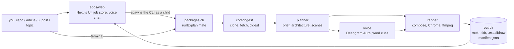

# How the code fits together

One page for whoever picks this up next: what each package owns, how a run moves through them,
which checks can stop a video, and where it still breaks.

## The shape of it

The web app is a thin shell: it stores one JSON file per job on disk, spawns `node packages/cli/bin/explanimate.mjs`
as a child process, and polls that JSON. All the work is in the CLI and the four packages under it.
There is no database. Up to `EXPLANIMATE_CONCURRENCY` renders (default 10) run at once; past that, jobs wait
in an in-memory first-in, first-out line and their page shows the first step in progress.

## Packages

| Package | Lines | What it owns |
|---|---|---|
| `packages/cli` | 1.2k | `pipeline.ts` runs one video start to finish, in order, and writes `manifest.json`. `bin.ts` is the argument parser and progress emitter. |
| `packages/core` | 2.0k | Shared contracts (`ExplainSpec`, `ScenePlan`, `Architecture`, `Film`), the validators that read narration, the repo digest, URL fetching, plan cache keys. No I/O beyond HTTP and git. |
| `packages/planner` | 1.9k | Four Muse calls that decide how to explain: `brief` picks analogy, depth, tempo, look; `architecture` finds the components and one request path; `scenes` writes the narration and the boards; `followups` makes the 15 s deep-dive and the what-if-10x clip. |
| `packages/voice` | 0.6k | Per-scene speech through Deepgram Aura, word timings, the respelling table for words Aura mispronounces, and the silent fallback when there is no key. |
| `packages/render` | 3.9k | The picture: layout, drawing, camera, captions, music and sound effects, `.tldr`/`.excalidraw` writers, the placement and frame checks, and the Chrome → ffmpeg capture. |
| `packages/models` | 0.4k | One client for Muse Spark (on OpenRouter or Meta, picked by `llmProvider` in `packages/core/src/llm.ts`), Meta Muse image, SAM and Transcribe, and Deepgram, with the cost ledger and retries. |
| `apps/web` | 1.9k | The UI, six job routes, the example gallery (`lib/gallery.ts`, read from `EXPLANIMATE_GALLERY_DIR`), the voice loop, the spend guard, rate limits, health. |

Two other packages carry the packs and the API/MCP surface; they are not on the demo path.

## A run, hop by hop

1. **Ingest.** A GitHub URL is cloned at a pinned commit and digested into a file tree plus excerpts; an
   article or X post is fetched and cleaned; a topic is read from Wikipedia and the pages it cites.
2. **Brief.** Muse picks the analogy, the audience, the depth and the tempo, and the engine overrides two
   of those decisions: a repo is always a whiteboard, and what the viewer asked for wins.
3. **Architecture.** Muse names 3 to 8 components, each backed by real file paths, then draws one request
   path through them. A validator drops components whose evidence does not exist, a reviewer re-reads it,
   and a fix pass applies the reviewer's patches.
4. **Scenes.** Muse writes the narration scene by scene, with the heading, the board nodes and the exact
   phrases the drawing will sync to. The plan is then polished for speech, renamed to plain keywords,
   self-checked, and repaired — a structural problem replans once, a wording problem gets a small rewrite and a second look, up to two rounds.
5. **Compose.** The plan becomes a `Film`: element positions and start times, camera keys, captions with
   per-word timings, headings, fades. No pixels yet.
6. **Voice.** Each scene is spoken, 8 at a time, and cut to word timings; the narration is mixed to one
   24 kHz track at the timeline offsets.
7. **Placement.** The film is checked against its own geometry — 7 rules, up to 8 fix passes, then a
   fallback pass that may widen the shot past the readable size.
8. **Boards.** `.tldr` and `.excalidraw` are written, read back, and compared to the sketch.
9. **Frames.** Chrome opens `stage.html`, seeks to each frame time, and screenshots 1080p JPEGs into a
   queue that ffmpeg is already encoding from stdin.
10. **Frame check.** A fresh Chrome seeks the same stage, asks where every element actually landed, and
    decodes the written JPEGs to catch blank frames.
11. **Manifest.** Stage timings, every check result, the cost ledger, and the duration.

## Checks: what can stop a run

| Check | Where | If it fails |
|---|---|---|
| architecture evidence | `planner/src/architecture.ts` | components are dropped and the reviewer's patches applied; never silent |
| scene self-check | `planner/src/scenes.ts` | structural → replan once; wording → one targeted rewrite |
| speech (articles, agreement, filler) | `core` + `planner` | the same targeted rewrite |
| placement | `render/src/placement.ts` | **throws** — no video |
| captions match narration | `render/src/check.ts` | **throws** |
| board read-back | `render/src/boardcheck.ts` | **throws** |
| frame check | `render/src/framecheck.ts` | recorded in `manifest.json` and the notes only |
| pace (cut rate, holds) | `render/src/pace.ts` | recorded only |
| voice QA (Muse Transcribe) | `cli/src/pipeline.ts` | recorded only |

So "nothing ships unchecked" is true, and "nothing ships broken" is not: a film whose frames slipped
past the placement model still encodes, with the problem written into the manifest. That is a deliberate
trade — a late frame issue should not throw away six minutes of drawing — but it means the manifest is
the place to look, not the exit code.

## Money and time, measured

A full run of `karpathy/minbpe` on the owner's laptop, everything already cached (plan and voice hit,
so `$0.00` of model spend):

| Stage | Seconds |
|---|---|
| ingest | 0.3 |
| brief, architecture, scene plan, voice | 0 (cache) |
| compose | 2.1 |
| draw 7,643 frames | 333 |
| frame check | 28.7 |
| encode tail + contact sheet | 11.2 |
| **total** | **383** (a 4:14 video) |

Frames draw at roughly 20 per second with the default worker count, so the wall clock is about 1.4×
the video length. Planning is the cheap part; the drawing is the cost in time. Model spend on a fresh
run of this size is a few cents of Spark plus a few cents of Aura.

The spend guard caps Meta at `$25` and Deepgram at `$10`, warns at 80%, and pauses new work rather than
overspending. Cached re-runs are genuinely free: `$0.000` on the run above.

## Where it can still bite you

**1. The render is the clock.**
Renders past `EXPLANIMATE_CONCURRENCY` wait for a slot (`pump` in `apps/web/lib/jobs.ts`), and a waiting job
is lost if the server restarts. With frames at ~20/s, a four-minute video is a six-minute wait, longer when
several draw at once on the same CPU.
A live "watch it make one" beat cannot fit in a three-minute demo; and the "30 second cached re-render"
in the older docs is wrong — the cache skips planning and voice (`0 s, $0.00`), then every frame is
redrawn, because the frames folder is deleted at the start of each run (`packages/cli/src/pipeline.ts:310`).

**2. A result opens paused on a still.**
Browsers block unmuted autoplay without a gesture. `Player` catches the rejection, seeks to 55% and
leaves it paused (`apps/web/components/Player.tsx:30-32`), so a link opened cold — `/?job=<id>` —
looks like a frozen frame with no narration. Enter through the form or the mic so a
click has happened, or click play once before the reveal.

**3. Voice mode has three doors, and all must be open.**
Microphone permission must be granted in the browser profile used for the demo; the three voice routes
refuse anything that is not loopback (`apps/web/lib/local.ts:10-14`), so a tunnel or a phone on the LAN
gets `voice mode only runs on localhost`; and under `next dev` the first `POST /api/voice/turn` pays a
cold compile, which reads as "Thinking…" hanging. Pre-warm it, or run `next build && next start`.

## Running it

- **Web:** `pnpm web`, keys in `apps/web/.env.local`; Next loads that file itself.
- **CLI:** `pnpm explanimate <url>`, keys in a `.env` or `.env.local` in the working directory
  (`packages/cli/src/bin.ts:7-13`). The CLI does not read `apps/web/.env.local`, so a fresh clone needs
  its own file at the root.
- **Tests:** `pnpm test` (220 tests, node:test, includes a synthetic Chrome+ffmpeg render).

## Two warts worth knowing

- The private-address guard is on for the web app (`apps/web/lib/jobs.ts` passes
  `EXPLANIMATE_ALLOW_PRIVATE_URLS=0`), and the local API, the MCP connector and the CLI refuse
  localhost and private-network links by default too. `EXPLANIMATE_ALLOW_PRIVATE_URLS=1` (or the CLI's
  `--allow-private`) lifts it for local intranet pages only; keep it off in anything that takes links from strangers.
- Chrome is looked for in three places (`packages/render/src/capture.ts`, `packages/ingest/src/concept.ts`,
  `apps/web/lib/health.ts`). All three now know the Windows folders, but the lists can drift again; if one
  starts a video and another reports the machine unhealthy, this is why.

